**AI를 사람들이 매일 쓰는 서비스로 만드는 개발자, 이재훈입니다.**

---

## 🏆 Awards

| 수상일 | 대회 · 과정 | 수상 내역 | 프로젝트 | 수여 기관 |
| :--: | :-- | :-- | :-- | :-- |
| 2026.08 | SSAFY 공통 프로젝트 | 우수상 (반 1위) | MODERA | 삼성전자 |
| 2026.07 | SSAFY 자율주행 레이싱 대회 (AirSim) | 전국 우승 (278팀) | 3인 팀 팀장 | 삼성 청년 SW·AI 아카데미 |
| 2026.06 | SSAFY 1학기 | 종합 성적우수상 | — | 삼성전자 |

## 🎓 Education

| 기간 | 교육 | 내용 |
| :--: | :-- | :-- |
| 2026.01 ~ 현재 | 삼성 청년 SW·AI 아카데미 (SSAFY) 15기 | 삼성전자가 운영하는 1년 과정의 SW·AI 개발자 교육 |
| 2024.06 ~ 2025.12 | 42경산 | Common Core, C/C++ 시스템 프로그래밍 (libft, printf, minishell, philosophers, pipex) |

## 🚀 Projects

| 프로젝트 | 서비스 | 담당 및 주요 경험 |
| :-- | :-- | :-- |
| **[Dver·Dva](https://github.com/42JH/DVA)** 2026.10 ~ 11 · 6인 · 기업 협업 | 전화로 택배를 접수하는 AI 상담원과 관리자 웹 | **관리자 웹 리드 · 배포** - 통화 후 고객 불만 자동 판정(정밀도 96%), AI 상담원 시나리오 자동 테스트, Nginx·Jenkins 배포 |
| **[SIA](https://github.com/42JH/SIA)** 2026.08 ~ 09 · 6인 | 시선과 음성으로 PC를 조작하는 데스크톱 AI 비서 | **AI 총괄 · 최종 발표** - 웹캠 시선 추정(오차 228→156px), LLM 판단 파이프라인, LLM 없이 처리하는 로컬 음성 명령(5→24/27) |
| **[MODERA](https://github.com/42JH/MODERA)** 2026.07 ~ 08 · 6인 | 스크린샷을 AI가 분류하고 자연어로 검색하는 앱 | **AI 서버 (API 23개 중 19개)** - 이미지 멀티모달 분석(분류 정확도 59→73%), 키워드·벡터 하이브리드 검색 |
| **AirSim Racing** 2026.05 ~ 07 · 3인 | 시뮬레이터 자율주행 알고리즘 대회 | **팀장 · 주행 알고리즘 전담** - 속도 계획, 장애물 회피, 사고 복구 |
| **[IT-doc](https://github.com/42JH/SSAFY1-PJT)** 2026 · SSAFY 1학기 | 증상으로 진료과와 가까운 병원을 추천하는 웹 서비스 | **Full Stack** - Django·Vue 기반 서비스 개발 |

---

## 🛠 Tech Stack

**Languages**  
  

**AI**  
   ![faster-whisper](https://img.shields.io/badge/faster--whisper-412991?style=flat-square&logo=data%3Aimage%2Fsvg%2Bxml%3Bbase64%2CPHN2ZyBmaWxsPSJ3aGl0ZSIgcm9sZT0iaW1nIiB2aWV3Qm94PSIwIDAgMjQgMjQiIHhtbG5zPSJodHRwOi8vd3d3LnczLm9yZy8yMDAwL3N2ZyI%2BPHRpdGxlPk9wZW5BSTwvdGl0bGU%2BPHBhdGggZD0iTTIyLjI4MTkgOS44MjExYTUuOTg0NyA1Ljk4NDcgMCAwIDAtLjUxNTctNC45MTA4IDYuMDQ2MiA2LjA0NjIgMCAwIDAtNi41MDk4LTIuOUE2LjA2NTEgNi4wNjUxIDAgMCAwIDQuOTgwNyA0LjE4MThhNS45ODQ3IDUuOTg0NyAwIDAgMC0zLjk5NzcgMi45IDYuMDQ2MiA2LjA0NjIgMCAwIDAgLjc0MjcgNy4wOTY2IDUuOTggNS45OCAwIDAgMCAuNTExIDQuOTEwNyA2LjA1MSA2LjA1MSAwIDAgMCA2LjUxNDYgMi45MDAxQTUuOTg0NyA1Ljk4NDcgMCAwIDAgMTMuMjU5OSAyNGE2LjA1NTcgNi4wNTU3IDAgMCAwIDUuNzcxOC00LjIwNTggNS45ODk0IDUuOTg5NCAwIDAgMCAzLjk5NzctMi45MDAxIDYuMDU1NyA2LjA1NTcgMCAwIDAtLjc0NzUtNy4wNzI5em0tOS4wMjIgMTIuNjA4MWE0LjQ3NTUgNC40NzU1IDAgMCAxLTIuODc2NC0xLjA0MDhsLjE0MTktLjA4MDQgNC43NzgzLTIuNzU4MmEuNzk0OC43OTQ4IDAgMCAwIC4zOTI3LS42ODEzdi02LjczNjlsMi4wMiAxLjE2ODZhLjA3MS4wNzEgMCAwIDEgLjAzOC4wNTJ2NS41ODI2YTQuNTA0IDQuNTA0IDAgMCAxLTQuNDk0NSA0LjQ5NDR6bS05LjY2MDctNC4xMjU0YTQuNDcwOCA0LjQ3MDggMCAwIDEtLjUzNDYtMy4wMTM3bC4xNDIuMDg1MiA0Ljc4MyAyLjc1ODJhLjc3MTIuNzcxMiAwIDAgMCAuNzgwNiAwbDUuODQyOC0zLjM2ODV2Mi4zMzI0YS4wODA0LjA4MDQgMCAwIDEtLjAzMzIuMDYxNUw5Ljc0IDE5Ljk1MDJhNC40OTkyIDQuNDk5MiAwIDAgMS02LjE0MDgtMS42NDY0ek0yLjM0MDggNy44OTU2YTQuNDg1IDQuNDg1IDAgMCAxIDIuMzY1NS0xLjk3MjhWMTEuNmEuNzY2NC43NjY0IDAgMCAwIC4zODc5LjY3NjVsNS44MTQ0IDMuMzU0My0yLjAyMDEgMS4xNjg1YS4wNzU3LjA3NTcgMCAwIDEtLjA3MSAwbC00LjgzMDMtMi43ODY1QTQuNTA0IDQuNTA0IDAgMCAxIDIuMzQwOCA3Ljg3MnptMTYuNTk2MyAzLjg1NThMMTMuMTAzOCA4LjM2NCAxNS4xMTkyIDcuMmEuMDc1Ny4wNzU3IDAgMCAxIC4wNzEgMGw0LjgzMDMgMi43OTEzYTQuNDk0NCA0LjQ5NDQgMCAwIDEtLjY3NjUgOC4xMDQydi01LjY3NzJhLjc5Ljc5IDAgMCAwLS40MDctLjY2N3ptMi4wMTA3LTMuMDIzMWwtLjE0Mi0uMDg1Mi00Ljc3MzUtMi43ODE4YS43NzU5Ljc3NTkgMCAwIDAtLjc4NTQgMEw5LjQwOSA5LjIyOTdWNi44OTc0YS4wNjYyLjA2NjIgMCAwIDEgLjAyODQtLjA2MTVsNC44MzAzLTIuNzg2NmE0LjQ5OTIgNC40OTkyIDAgMCAxIDYuNjgwMiA0LjY2ek04LjMwNjUgMTIuODYzbC0yLjAyLTEuMTYzOGEuMDgwNC4wODA0IDAgMCAxLS4wMzgtLjA1NjdWNi4wNzQyYTQuNDk5MiA0LjQ5OTIgMCAwIDEgNy4zNzU3LTMuNDUzN2wtLjE0Mi4wODA1TDguNzA0IDUuNDU5YS43OTQ4Ljc5NDggMCAwIDAtLjM5MjcuNjgxM3ptMS4wOTc2LTIuMzY1NGwyLjYwMi0xLjQ5OTggMi42MDY5IDEuNDk5OHYyLjk5OTRsLTIuNTk3NCAxLjQ5OTctMi42MDY3LTEuNDk5N1oiLz48L3N2Zz4%3D&logoColor=white)  ![OpenAI API](https://img.shields.io/badge/OpenAI_API-412991?style=flat-square&logo=data%3Aimage%2Fsvg%2Bxml%3Bbase64%2CPHN2ZyBmaWxsPSJ3aGl0ZSIgcm9sZT0iaW1nIiB2aWV3Qm94PSIwIDAgMjQgMjQiIHhtbG5zPSJodHRwOi8vd3d3LnczLm9yZy8yMDAwL3N2ZyI%2BPHRpdGxlPk9wZW5BSTwvdGl0bGU%2BPHBhdGggZD0iTTIyLjI4MTkgOS44MjExYTUuOTg0NyA1Ljk4NDcgMCAwIDAtLjUxNTctNC45MTA4IDYuMDQ2MiA2LjA0NjIgMCAwIDAtNi41MDk4LTIuOUE2LjA2NTEgNi4wNjUxIDAgMCAwIDQuOTgwNyA0LjE4MThhNS45ODQ3IDUuOTg0NyAwIDAgMC0zLjk5NzcgMi45IDYuMDQ2MiA2LjA0NjIgMCAwIDAgLjc0MjcgNy4wOTY2IDUuOTggNS45OCAwIDAgMCAuNTExIDQuOTEwNyA2LjA1MSA2LjA1MSAwIDAgMCA2LjUxNDYgMi45MDAxQTUuOTg0NyA1Ljk4NDcgMCAwIDAgMTMuMjU5OSAyNGE2LjA1NTcgNi4wNTU3IDAgMCAwIDUuNzcxOC00LjIwNTggNS45ODk0IDUuOTg5NCAwIDAgMCAzLjk5NzctMi45MDAxIDYuMDU1NyA2LjA1NTcgMCAwIDAtLjc0NzUtNy4wNzI5em0tOS4wMjIgMTIuNjA4MWE0LjQ3NTUgNC40NzU1IDAgMCAxLTIuODc2NC0xLjA0MDhsLjE0MTktLjA4MDQgNC43NzgzLTIuNzU4MmEuNzk0OC43OTQ4IDAgMCAwIC4zOTI3LS42ODEzdi02LjczNjlsMi4wMiAxLjE2ODZhLjA3MS4wNzEgMCAwIDEgLjAzOC4wNTJ2NS41ODI2YTQuNTA0IDQuNTA0IDAgMCAxLTQuNDk0NSA0LjQ5NDR6bS05LjY2MDctNC4xMjU0YTQuNDcwOCA0LjQ3MDggMCAwIDEtLjUzNDYtMy4wMTM3bC4xNDIuMDg1MiA0Ljc4MyAyLjc1ODJhLjc3MTIuNzcxMiAwIDAgMCAuNzgwNiAwbDUuODQyOC0zLjM2ODV2Mi4zMzI0YS4wODA0LjA4MDQgMCAwIDEtLjAzMzIuMDYxNUw5Ljc0IDE5Ljk1MDJhNC40OTkyIDQuNDk5MiAwIDAgMS02LjE0MDgtMS42NDY0ek0yLjM0MDggNy44OTU2YTQuNDg1IDQuNDg1IDAgMCAxIDIuMzY1NS0xLjk3MjhWMTEuNmEuNzY2NC43NjY0IDAgMCAwIC4zODc5LjY3NjVsNS44MTQ0IDMuMzU0My0yLjAyMDEgMS4xNjg1YS4wNzU3LjA3NTcgMCAwIDEtLjA3MSAwbC00LjgzMDMtMi43ODY1QTQuNTA0IDQuNTA0IDAgMCAxIDIuMzQwOCA3Ljg3MnptMTYuNTk2MyAzLjg1NThMMTMuMTAzOCA4LjM2NCAxNS4xMTkyIDcuMmEuMDc1Ny4wNzU3IDAgMCAxIC4wNzEgMGw0LjgzMDMgMi43OTEzYTQuNDk0NCA0LjQ5NDQgMCAwIDEtLjY3NjUgOC4xMDQydi01LjY3NzJhLjc5Ljc5IDAgMCAwLS40MDctLjY2N3ptMi4wMTA3LTMuMDIzMWwtLjE0Mi0uMDg1Mi00Ljc3MzUtMi43ODE4YS43NzU5Ljc3NTkgMCAwIDAtLjc4NTQgMEw5LjQwOSA5LjIyOTdWNi44OTc0YS4wNjYyLjA2NjIgMCAwIDEgLjAyODQtLjA2MTVsNC44MzAzLTIuNzg2NmE0LjQ5OTIgNC40OTkyIDAgMCAxIDYuNjgwMiA0LjY2ek04LjMwNjUgMTIuODYzbC0yLjAyLTEuMTYzOGEuMDgwNC4wODA0IDAgMCAxLS4wMzgtLjA1NjdWNi4wNzQyYTQuNDk5MiA0LjQ5OTIgMCAwIDEgNy4zNzU3LTMuNDUzN2wtLjE0Mi4wODA1TDguNzA0IDUuNDU5YS43OTQ4Ljc5NDggMCAwIDAtLjM5MjcuNjgxM3ptMS4wOTc2LTIuMzY1NGwyLjYwMi0xLjQ5OTggMi42MDY5IDEuNDk5OHYyLjk5OTRsLTIuNTk3NCAxLjQ5OTctMi42MDY3LTEuNDk5N1oiLz48L3N2Zz4%3D&logoColor=white)

**Backend**  
  

**Frontend**  
      

**DevOps**  
   ![AWS](https://img.shields.io/badge/AWS-232F3E?style=flat-square&logo=data%3Aimage%2Fsvg%2Bxml%3Bbase64%2CPHN2ZyB4bWxucz0iaHR0cDovL3d3dy53My5vcmcvMjAwMC9zdmciIHZpZXdCb3g9IjAgMCAyNCAyNCIgZmlsbD0id2hpdGUiPjxwYXRoIGQ9Ik0gNi44IDEwYyAwIDAuMyAwIDAuNSAwLjEgMC43IDAuMSAwLjIgMC4xIDAuNCAwLjMgMC42IDAgMC4xIDAuMSAwLjEgMC4xIDAuMiAwIDAuMSAwIDAuMi0wLjIgMC4ybC0wLjUgMC4zYSAwLjQgMC40IDAgMCAxLTAuMiAwLjFjLTAuMSAwLTAuMiAwLTAuMi0wLjFhIDIuNSAyLjUgMCAwIDEtMC4zLTAuNCA2LjIgNi4yIDAgMCAxLTAuMi0wLjVjLTAuNiAwLjctMS40IDEuMS0yLjMgMS4xLTAuNyAwLTEuMi0wLjItMS42LTAuNi0wLjQtMC40LTAuNi0wLjktMC42LTEuNSAwLTAuNyAwLjItMS4yIDAuNy0xLjYgMC41LTAuNCAxLjEtMC42IDItMC42IDAuMyAwIDAuNiAwIDAuOCAwLjEgMC4zIDAgMC42IDAuMSAwLjkgMC4ydi0wLjZjIDAtMC42LTAuMS0xLTAuNC0xLjMtMC4zLTAuMi0wLjctMC40LTEuMy0wLjQtMC4zIDAtMC42IDAtMC45IDAuMS0wLjMgMC4xLTAuNiAwLjItMC45IDAuM2EgMi4zIDIuMyAwIDAgMS0wLjMgMC4xIDAuNSAwLjUgMCAwIDEtMC4xIDBjLTAuMSAwLTAuMi0wLjEtMC4yLTAuMnYtMC40YyAwLTAuMSAwLTAuMiAwLjEtMC4zYSAwLjYgMC42IDAgMCAxIDAuMi0wLjJjIDAuMy0wLjEgMC42LTAuMyAxLTAuNGEgNC44IDQuOCAwIDAgMSAxLjItMC4yYyAwLjkgMCAxLjYgMC4yIDIuMSAwLjYgMC40IDAuNCAwLjcgMS4xIDAuNyAydiAyLjZ6bS0zLjIgMS4yYyAwLjMgMCAwLjUgMCAwLjgtMC4xIDAuMy0wLjEgMC41LTAuMyAwLjgtMC41IDAuMS0wLjIgMC4yLTAuMyAwLjMtMC41IDAtMC4yIDAuMS0wLjQgMC4xLTAuN3YtMC4zYSA2LjcgNi43IDAgMCAwLTAuNy0wLjEgNiA2IDAgMCAwLTAuOCAwYy0wLjUgMC0wLjkgMC4xLTEuMiAwLjMtMC4zIDAuMi0wLjQgMC41LTAuNCAwLjkgMCAwLjQgMC4xIDAuNyAwLjMgMC44IDAuMiAwLjIgMC41IDAuMyAwLjggMC4zem0gNi40IDAuOWMtMC4xIDAtMC4yIDAtMC4zLTAuMS0wLjEgMC0wLjEtMC4yLTAuMi0wLjNMIDcuNiA1LjVhIDEuNCAxLjQgMCAwIDEtMC4xLTAuM2MgMC0wLjEgMC4xLTAuMiAwLjItMC4yaCAwLjhjIDAuMiAwIDAuMyAwIDAuMyAwLjEgMC4xIDAgMC4xIDAuMiAwLjIgMC4zbCAxLjMgNS4zIDEuMi01LjNjIDAtMC4yIDAuMS0wLjMgMC4yLTAuM2EgMC41IDAuNSAwIDAgMSAwLjMtMC4xaCAwLjZjIDAuMiAwIDAuMyAwIDAuMyAwLjEgMC4xIDAgMC4xIDAuMiAwLjIgMC4zbCAxLjMgNS4zIDEuNC01LjNjIDAtMC4yIDAuMS0wLjMgMC4yLTAuM2EgMC41IDAuNSAwIDAgMSAwLjMtMC4xaCAwLjdjIDAuMSAwIDAuMiAwLjEgMC4yIDAuMiAwIDAgMCAwLjEgMCAwLjFhIDEuMSAxLjEgMCAwIDEtMC4xIDAuMmwtMS45IDYuMmMgMCAwLjItMC4xIDAuMy0wLjIgMC4zYSAwLjUgMC41IDAgMCAxLTAuMyAwLjFoLTAuN2MtMC4yIDAtMC4zIDAtMC4zLTAuMS0wLjEtMC4xLTAuMS0wLjItMC4xLTAuM2wtMS4yLTUuMS0xLjIgNS4xYyAwIDAuMi0wLjEgMC4zLTAuMSAwLjMtMC4xIDAuMS0wLjIgMC4xLTAuMyAwLjF6bSAxMC4zIDAuMmMtMC40IDAtMC44IDAtMS4yLTAuMS0wLjQtMC4xLTAuNy0wLjItMC45LTAuMy0wLjEtMC4xLTAuMi0wLjItMC4yLTAuMmEgMC42IDAuNiAwIDAgMSAwLTAuMnYtMC40YyAwLTAuMiAwLjEtMC4yIDAuMi0wLjIgMCAwIDAuMSAwIDAuMSAwIDAgMCAwLjEgMCAwLjIgMC4xIDAuMyAwLjEgMC42IDAuMiAwLjkgMC4zIDAuMyAwLjEgMC42IDAuMSAwLjkgMC4xIDAuNSAwIDAuOS0wLjEgMS4yLTAuM2EgMC45IDAuOSAwIDAgMCAwLjQtMC44IDAuOCAwLjggMCAwIDAtMC4yLTAuNmMtMC4xLTAuMi0wLjQtMC4zLTAuOC0wLjRsLTEuMi0wLjRjLTAuNi0wLjItMS0wLjUtMS4zLTAuOGEgMS45IDEuOSAwIDAgMS0wLjQtMS4yYyAwLTAuMyAwLjEtMC42IDAuMi0wLjkgMC4xLTAuMyAwLjMtMC41IDAuNi0wLjcgMC4yLTAuMiAwLjUtMC4zIDAuOC0wLjQgMC4zLTAuMSAwLjctMC4xIDEtMC4xIDAuMiAwIDAuNCAwIDAuNSAwIDAuMiAwIDAuMyAwLjEgMC41IDAuMSAwLjIgMCAwLjMgMC4xIDAuNSAwLjEgMC4xIDAgMC4zIDAuMSAwLjMgMC4xYSAwLjcgMC43IDAgMCAxIDAuMiAwLjIgMC40IDAuNCAwIDAgMSAwLjEgMC4zdiAwLjRjIDAgMC4yLTAuMSAwLjMtMC4yIDAuM2EgMC44IDAuOCAwIDAgMS0wLjMtMC4xIDMuNyAzLjcgMCAwIDAtMS41LTAuM2MtMC41IDAtMC44IDAuMS0xLjEgMC4yLTAuMiAwLjItMC40IDAuNC0wLjQgMC43IDAgMC4yIDAuMSAwLjQgMC4yIDAuNiAwLjIgMC4yIDAuNSAwLjMgMC45IDAuNGwgMS4xIDAuNGMgMC42IDAuMiAxIDAuNCAxLjIgMC44IDAuMiAwLjMgMC40IDAuNyAwLjQgMS4xIDAgMC4zLTAuMSAwLjctMC4yIDAuOS0wLjEgMC4zLTAuMyAwLjUtMC42IDAuNy0wLjIgMC4yLTAuNSAwLjMtMC45IDAuNC0wLjQgMC4xLTAuNyAwLjItMS4xIDAuMnpNIDIxLjcgMTYuMmMtMi42IDEuOS02LjQgMy05LjcgMy00LjYgMC04LjctMS43LTExLjktNC41LTAuMi0wLjIgMC0wLjUgMC4zLTAuNCAzLjQgMiA3LjYgMy4yIDExLjkgMy4yIDIuOSAwIDYuMS0wLjYgOS4xLTEuOSAwLjQtMC4yIDAuOCAwLjMgMC40IDAuNnpNIDIyLjggMTVjLTAuMy0wLjQtMi4yLTAuMi0zLjEtMC4xLTAuMyAwLTAuMy0wLjItMC4xLTAuNCAxLjUtMS4xIDQtMC44IDQuMy0wLjQgMC4zIDAuNC0wLjEgMi44LTEuNSA0LTAuMiAwLjItMC40IDAuMS0wLjMtMC4yIDAuMy0wLjggMS0yLjYgMC43LTN6Ii8%2BPC9zdmc%2B&logoColor=white) 

**Collaboration**  
    

