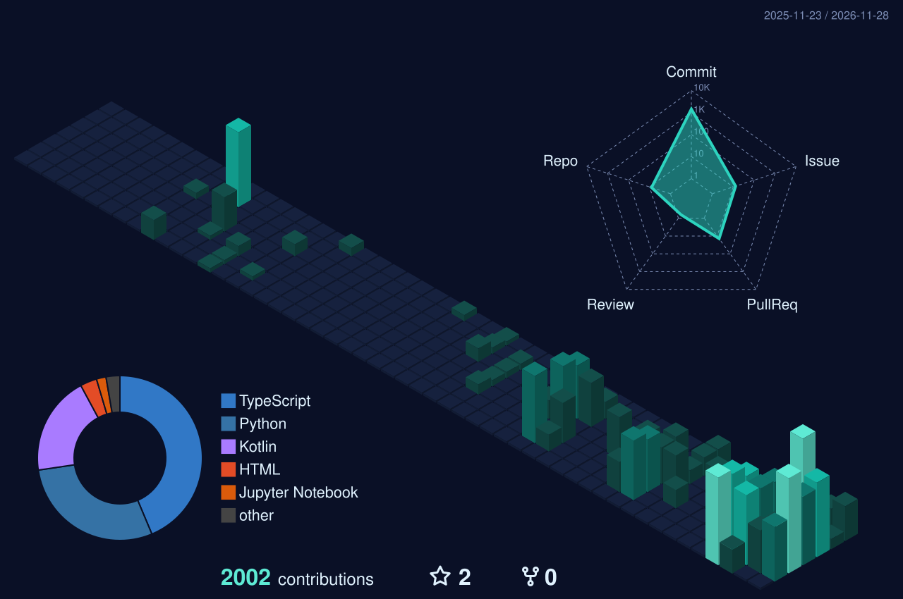

# 안녕하세요, 이재훈입니다.

AI 기술을 사람들의 일상 속으로 옮깁니다.

---

## Experience

### 삼성 청년 SW·AI 아카데미 (SSAFY) 15기
`2026.01 ~ 현재` · 삼성전자가 운영하는 1년 과정의 SW·AI 개발자 교육

- **1학기** · SW·AI 이론 및 실습 (Python, Django, Vue)
  - 🏆 **1학기 성적우수상**
  - 관통 프로젝트 **[IT-doc](https://github.com/42JH/SSAFY1-PJT)** : 증상으로 진료과와 가까운 병원을 추천하는 웹 서비스
- **2026.05 ~ 07** · AirSim 자율주행 레이싱 대회
  - 🏆 **전국 우승** (278팀 중 리그 1위, 결승 토너먼트 우승)
  - 3인 팀 팀장, 주행 알고리즘 전담
- **2026.07 ~ 08** · 6인 프로젝트 **[MODERA](https://github.com/42JH/MODERA)** : AI 스크린샷 분류·검색 앱
  - 🏆 **팀 프로젝트 우수상** (반 1위, 전국 발표회 발표)
  - AI 서버 분석·검색 담당 (API 23개 중 19개)
- **2026.08 ~ 09** · 6인 프로젝트 **[SIA](https://github.com/42JH/SIA)** : 시선·음성 기반 데스크톱 AI 비서
  - 시선 추적, LLM 판단, 음성 라우터 담당 · 최종 발표
- **2026.10 ~ 11** · 6인 기업 협업 프로젝트 **[Dver·Dva](https://github.com/42JH/DVA)** : 전화로 택배를 접수하는 AI 상담원
  - 관리자 웹 리드, 배포, AI 응대 품질 테스트
- **알고리즘·CS 스터디** 스터디장 (5인) · [SSAFY_STUDY](https://github.com/42JH/SSAFY_STUDY)

### 42경산
`2024.06 ~ 2025.12` · Common Core (C/C++)

- libft, printf, minishell, philosophers, pipex 등 시스템 프로그래밍 과제

---

## Tech Stack

| 분야 | 기술 | 이렇게 썼어요 |
| :--: | :-- | :-- |
| **AI** |    ![faster-whisper](https://img.shields.io/badge/faster--whisper-412991?style=flat-square&logo=data%3Aimage%2Fsvg%2Bxml%3Bbase64%2CPHN2ZyBmaWxsPSJ3aGl0ZSIgcm9sZT0iaW1nIiB2aWV3Qm94PSIwIDAgMjQgMjQiIHhtbG5zPSJodHRwOi8vd3d3LnczLm9yZy8yMDAwL3N2ZyI%2BPHRpdGxlPk9wZW5BSTwvdGl0bGU%2BPHBhdGggZD0iTTIyLjI4MTkgOS44MjExYTUuOTg0NyA1Ljk4NDcgMCAwIDAtLjUxNTctNC45MTA4IDYuMDQ2MiA2LjA0NjIgMCAwIDAtNi41MDk4LTIuOUE2LjA2NTEgNi4wNjUxIDAgMCAwIDQuOTgwNyA0LjE4MThhNS45ODQ3IDUuOTg0NyAwIDAgMC0zLjk5NzcgMi45IDYuMDQ2MiA2LjA0NjIgMCAwIDAgLjc0MjcgNy4wOTY2IDUuOTggNS45OCAwIDAgMCAuNTExIDQuOTEwNyA2LjA1MSA2LjA1MSAwIDAgMCA2LjUxNDYgMi45MDAxQTUuOTg0NyA1Ljk4NDcgMCAwIDAgMTMuMjU5OSAyNGE2LjA1NTcgNi4wNTU3IDAgMCAwIDUuNzcxOC00LjIwNTggNS45ODk0IDUuOTg5NCAwIDAgMCAzLjk5NzctMi45MDAxIDYuMDU1NyA2LjA1NTcgMCAwIDAtLjc0NzUtNy4wNzI5em0tOS4wMjIgMTIuNjA4MWE0LjQ3NTUgNC40NzU1IDAgMCAxLTIuODc2NC0xLjA0MDhsLjE0MTktLjA4MDQgNC43NzgzLTIuNzU4MmEuNzk0OC43OTQ4IDAgMCAwIC4zOTI3LS42ODEzdi02LjczNjlsMi4wMiAxLjE2ODZhLjA3MS4wNzEgMCAwIDEgLjAzOC4wNTJ2NS41ODI2YTQuNTA0IDQuNTA0IDAgMCAxLTQuNDk0NSA0LjQ5NDR6bS05LjY2MDctNC4xMjU0YTQuNDcwOCA0LjQ3MDggMCAwIDEtLjUzNDYtMy4wMTM3bC4xNDIuMDg1MiA0Ljc4MyAyLjc1ODJhLjc3MTIuNzcxMiAwIDAgMCAuNzgwNiAwbDUuODQyOC0zLjM2ODV2Mi4zMzI0YS4wODA0LjA4MDQgMCAwIDEtLjAzMzIuMDYxNUw5Ljc0IDE5Ljk1MDJhNC40OTkyIDQuNDk5MiAwIDAgMS02LjE0MDgtMS42NDY0ek0yLjM0MDggNy44OTU2YTQuNDg1IDQuNDg1IDAgMCAxIDIuMzY1NS0xLjk3MjhWMTEuNmEuNzY2NC43NjY0IDAgMCAwIC4zODc5LjY3NjVsNS44MTQ0IDMuMzU0My0yLjAyMDEgMS4xNjg1YS4wNzU3LjA3NTcgMCAwIDEtLjA3MSAwbC00LjgzMDMtMi43ODY1QTQuNTA0IDQuNTA0IDAgMCAxIDIuMzQwOCA3Ljg3MnptMTYuNTk2MyAzLjg1NThMMTMuMTAzOCA4LjM2NCAxNS4xMTkyIDcuMmEuMDc1Ny4wNzU3IDAgMCAxIC4wNzEgMGw0LjgzMDMgMi43OTEzYTQuNDk0NCA0LjQ5NDQgMCAwIDEtLjY3NjUgOC4xMDQydi01LjY3NzJhLjc5Ljc5IDAgMCAwLS40MDctLjY2N3ptMi4wMTA3LTMuMDIzMWwtLjE0Mi0uMDg1Mi00Ljc3MzUtMi43ODE4YS43NzU5Ljc3NTkgMCAwIDAtLjc4NTQgMEw5LjQwOSA5LjIyOTdWNi44OTc0YS4wNjYyLjA2NjIgMCAwIDEgLjAyODQtLjA2MTVsNC44MzAzLTIuNzg2NmE0LjQ5OTIgNC40OTkyIDAgMCAxIDYuNjgwMiA0LjY2ek04LjMwNjUgMTIuODYzbC0yLjAyLTEuMTYzOGEuMDgwNC4wODA0IDAgMCAxLS4wMzgtLjA1NjdWNi4wNzQyYTQuNDk5MiA0LjQ5OTIgMCAwIDEgNy4zNzU3LTMuNDUzN2wtLjE0Mi4wODA1TDguNzA0IDUuNDU5YS43OTQ4Ljc5NDggMCAwIDAtLjM5MjcuNjgxM3ptMS4wOTc2LTIuMzY1NGwyLjYwMi0xLjQ5OTggMi42MDY5IDEuNDk5OHYyLjk5OTRsLTIuNTk3NCAxLjQ5OTctMi42MDY3LTEuNDk5N1oiLz48L3N2Zz4%3D&logoColor=white)  ![OpenAI API](https://img.shields.io/badge/OpenAI_API-412991?style=flat-square&logo=data%3Aimage%2Fsvg%2Bxml%3Bbase64%2CPHN2ZyBmaWxsPSJ3aGl0ZSIgcm9sZT0iaW1nIiB2aWV3Qm94PSIwIDAgMjQgMjQiIHhtbG5zPSJodHRwOi8vd3d3LnczLm9yZy8yMDAwL3N2ZyI%2BPHRpdGxlPk9wZW5BSTwvdGl0bGU%2BPHBhdGggZD0iTTIyLjI4MTkgOS44MjExYTUuOTg0NyA1Ljk4NDcgMCAwIDAtLjUxNTctNC45MTA4IDYuMDQ2MiA2LjA0NjIgMCAwIDAtNi41MDk4LTIuOUE2LjA2NTEgNi4wNjUxIDAgMCAwIDQuOTgwNyA0LjE4MThhNS45ODQ3IDUuOTg0NyAwIDAgMC0zLjk5NzcgMi45IDYuMDQ2MiA2LjA0NjIgMCAwIDAgLjc0MjcgNy4wOTY2IDUuOTggNS45OCAwIDAgMCAuNTExIDQuOTEwNyA2LjA1MSA2LjA1MSAwIDAgMCA2LjUxNDYgMi45MDAxQTUuOTg0NyA1Ljk4NDcgMCAwIDAgMTMuMjU5OSAyNGE2LjA1NTcgNi4wNTU3IDAgMCAwIDUuNzcxOC00LjIwNTggNS45ODk0IDUuOTg5NCAwIDAgMCAzLjk5NzctMi45MDAxIDYuMDU1NyA2LjA1NTcgMCAwIDAtLjc0NzUtNy4wNzI5em0tOS4wMjIgMTIuNjA4MWE0LjQ3NTUgNC40NzU1IDAgMCAxLTIuODc2NC0xLjA0MDhsLjE0MTktLjA4MDQgNC43NzgzLTIuNzU4MmEuNzk0OC43OTQ4IDAgMCAwIC4zOTI3LS42ODEzdi02LjczNjlsMi4wMiAxLjE2ODZhLjA3MS4wNzEgMCAwIDEgLjAzOC4wNTJ2NS41ODI2YTQuNTA0IDQuNTA0IDAgMCAxLTQuNDk0NSA0LjQ5NDR6bS05LjY2MDctNC4xMjU0YTQuNDcwOCA0LjQ3MDggMCAwIDEtLjUzNDYtMy4wMTM3bC4xNDIuMDg1MiA0Ljc4MyAyLjc1ODJhLjc3MTIuNzcxMiAwIDAgMCAuNzgwNiAwbDUuODQyOC0zLjM2ODV2Mi4zMzI0YS4wODA0LjA4MDQgMCAwIDEtLjAzMzIuMDYxNUw5Ljc0IDE5Ljk1MDJhNC40OTkyIDQuNDk5MiAwIDAgMS02LjE0MDgtMS42NDY0ek0yLjM0MDggNy44OTU2YTQuNDg1IDQuNDg1IDAgMCAxIDIuMzY1NS0xLjk3MjhWMTEuNmEuNzY2NC43NjY0IDAgMCAwIC4zODc5LjY3NjVsNS44MTQ0IDMuMzU0My0yLjAyMDEgMS4xNjg1YS4wNzU3LjA3NTcgMCAwIDEtLjA3MSAwbC00LjgzMDMtMi43ODY1QTQuNTA0IDQuNTA0IDAgMCAxIDIuMzQwOCA3Ljg3MnptMTYuNTk2MyAzLjg1NThMMTMuMTAzOCA4LjM2NCAxNS4xMTkyIDcuMmEuMDc1Ny4wNzU3IDAgMCAxIC4wNzEgMGw0LjgzMDMgMi43OTEzYTQuNDk0NCA0LjQ5NDQgMCAwIDEtLjY3NjUgOC4xMDQydi01LjY3NzJhLjc5Ljc5IDAgMCAwLS40MDctLjY2N3ptMi4wMTA3LTMuMDIzMWwtLjE0Mi0uMDg1Mi00Ljc3MzUtMi43ODE4YS43NzU5Ljc3NTkgMCAwIDAtLjc4NTQgMEw5LjQwOSA5LjIyOTdWNi44OTc0YS4wNjYyLjA2NjIgMCAwIDEgLjAyODQtLjA2MTVsNC44MzAzLTIuNzg2NmE0LjQ5OTIgNC40OTkyIDAgMCAxIDYuNjgwMiA0LjY2ek04LjMwNjUgMTIuODYzbC0yLjAyLTEuMTYzOGEuMDgwNC4wODA0IDAgMCAxLS4wMzgtLjA1NjdWNi4wNzQyYTQuNDk5MiA0LjQ5OTIgMCAwIDEgNy4zNzU3LTMuNDUzN2wtLjE0Mi4wODA1TDguNzA0IDUuNDU5YS43OTQ4Ljc5NDggMCAwIDAtLjM5MjcuNjgxM3ptMS4wOTc2LTIuMzY1NGwyLjYwMi0xLjQ5OTggMi42MDY5IDEuNDk5OHYyLjk5OTRsLTIuNTk3NCAxLjQ5OTctMi42MDY3LTEuNDk5N1oiLz48L3N2Zz4%3D&logoColor=white) | 웹캠 시선 추정, 음성 명령 인식, 이미지 멀티모달 분석, 통화 불만 판정 |
| **Backend** |     | AI 분석·검색 API 서버, 하이브리드 검색, 병원 추천 웹 API |
| **Frontend** |        | 관리자 웹 전반, 성능·접근성 개선, 목 API 테스트 |
| **DevOps** |    ![AWS](https://img.shields.io/badge/AWS-232F3E?style=flat-square&logo=data%3Aimage%2Fsvg%2Bxml%3Bbase64%2CPHN2ZyBmaWxsPSJ3aGl0ZSIgcm9sZT0iaW1nIiB2aWV3Qm94PSIwIDAgMjQgMjQiIHhtbG5zPSJodHRwOi8vd3d3LnczLm9yZy8yMDAwL3N2ZyI%2BPHRpdGxlPkFtYXpvbiBBV1M8L3RpdGxlPjxwYXRoIGQ9Ik02Ljc2MyAxMC4wMzZjMCAuMjk2LjAzMi41MzUuMDg4LjcxLjA2NC4xNzYuMTQ0LjM2OC4yNTYuNTc2LjA0LjA2My4wNTYuMTI3LjA1Ni4xODMgMCAuMDgtLjA0OC4xNi0uMTUyLjI0bC0uNTAzLjMzNWEuMzgzLjM4MyAwIDAgMS0uMjA4LjA3MmMtLjA4IDAtLjE2LS4wNC0uMjM5LS4xMTJhMi40NyAyLjQ3IDAgMCAxLS4yODctLjM3NSA2LjE4IDYuMTggMCAwIDEtLjI0OC0uNDcxYy0uNjIyLjczNC0xLjQwNSAxLjEwMS0yLjM0NyAxLjEwMS0uNjcgMC0xLjIwNS0uMTkxLTEuNTk2LS41NzQtLjM5MS0uMzg0LS41OS0uODk0LS41OS0xLjUzMyAwLS42NzguMjM5LTEuMjMuNzI2LTEuNjQ0LjQ4Ny0uNDE1IDEuMTMzLS42MjMgMS45NTUtLjYyMy4yNzIgMCAuNTUxLjAyNC44NDYuMDY0LjI5Ni4wNC42LjEwNC45MTguMTc2di0uNTgzYzAtLjYwNy0uMTI3LTEuMDMtLjM3NS0xLjI3Ny0uMjU1LS4yNDgtLjY4Ni0uMzY3LTEuMy0uMzY3LS4yOCAwLS41NjguMDMxLS44NjMuMTAzLS4yOTUuMDcyLS41ODMuMTYtLjg2Mi4yNzJhMi4yODcgMi4yODcgMCAwIDEtLjI4LjEwNC40ODguNDg4IDAgMCAxLS4xMjcuMDIzYy0uMTEyIDAtLjE2OC0uMDgtLjE2OC0uMjQ3di0uMzkxYzAtLjEyOC4wMTYtLjIyNC4wNTYtLjI4YS41OTcuNTk3IDAgMCAxIC4yMjQtLjE2N2MuMjc5LS4xNDQuNjE0LS4yNjQgMS4wMDUtLjM2YTQuODQgNC44NCAwIDAgMSAxLjI0Ni0uMTUxYy45NSAwIDEuNjQ0LjIxNiAyLjA5MS42NDcuNDM5LjQzLjY2MiAxLjA4NS42NjIgMS45NjN2Mi41ODZ6bS0zLjI0IDEuMjE0Yy4yNjMgMCAuNTM0LS4wNDguODIyLS4xNDQuMjg3LS4wOTYuNTQzLS4yNzEuNzU4LS41MS4xMjgtLjE1Mi4yMjQtLjMyLjI3Mi0uNTEyLjA0Ny0uMTkxLjA4LS40MjMuMDgtLjY5NHYtLjMzNWE2LjY2IDYuNjYgMCAwIDAtLjczNS0uMTM2IDYuMDIgNi4wMiAwIDAgMC0uNzUtLjA0OGMtLjUzNSAwLS45MjYuMTA0LTEuMTkuMzItLjI2My4yMTUtLjM5LjUxOC0uMzkuOTE3IDAgLjM3NS4wOTUuNjU1LjI5NS44NDYuMTkxLjIuNDcuMjk2LjgzOC4yOTZ6bTYuNDEuODYyYy0uMTQ0IDAtLjI0LS4wMjQtLjMwNC0uMDgtLjA2NC0uMDQ4LS4xMi0uMTYtLjE2OC0uMzExTDcuNTg2IDUuNTVhMS4zOTggMS4zOTggMCAwIDEtLjA3Mi0uMzJjMC0uMTI4LjA2NC0uMi4xOTEtLjJoLjc4M2MuMTUxIDAgLjI1NS4wMjUuMzEuMDguMDY1LjA0OC4xMTMuMTYuMTYuMzEybDEuMzQyIDUuMjg0IDEuMjQ1LTUuMjg0Yy4wNC0uMTYuMDg4LS4yNjQuMTUxLS4zMTJhLjU0OS41NDkgMCAwIDEgLjMyLS4wOGguNjM4Yy4xNTIgMCAuMjU2LjAyNS4zMi4wOC4wNjMuMDQ4LjEyLjE2LjE1MS4zMTJsMS4yNjEgNS4zNDggMS4zODEtNS4zNDhjLjA0OC0uMTYuMTA0LS4yNjQuMTYtLjMxMmEuNTIuNTIgMCAwIDEgLjMxMS0uMDhoLjc0M2MuMTI3IDAgLjIuMDY1LjIuMiAwIC4wNC0uMDA5LjA4LS4wMTcuMTI4YTEuMTM3IDEuMTM3IDAgMCAxLS4wNTYuMmwtMS45MjMgNi4xN2MtLjA0OC4xNi0uMTA0LjI2My0uMTY4LjMxMWEuNTEuNTEgMCAwIDEtLjMwMy4wOGgtLjY4N2MtLjE1MSAwLS4yNTUtLjAyNC0uMzItLjA4LS4wNjMtLjA1Ni0uMTE5LS4xNi0uMTUtLjMybC0xLjIzOC01LjE0OC0xLjIzIDUuMTRjLS4wNC4xNi0uMDg3LjI2NC0uMTUuMzItLjA2NS4wNTYtLjE3Ny4wOC0uMzIuMDh6bTEwLjI1Ni4yMTVjLS40MTUgMC0uODMtLjA0OC0xLjIyOS0uMTQzLS4zOTktLjA5Ni0uNzEtLjItLjkxOC0uMzItLjEyOC0uMDcxLS4yMTUtLjE1MS0uMjQ3LS4yMjNhLjU2My41NjMgMCAwIDEtLjA0OC0uMjI0di0uNDA3YzAtLjE2Ny4wNjQtLjI0Ny4xODMtLjI0Ny4wNDggMCAuMDk2LjAwOC4xNDQuMDI0LjA0OC4wMTYuMTIuMDQ4LjIuMDguMjcxLjEyLjU2Ni4yMTUuODc4LjI3OS4zMTkuMDY0LjYzLjA5Ni45NS4wOTYuNTAyIDAgLjg5NC0uMDg4IDEuMTY1LS4yNjRhLjg2Ljg2IDAgMCAwIC40MTUtLjc1OC43NzcuNzc3IDAgMCAwLS4yMTUtLjU1OWMtLjE0NC0uMTUxLS40MTYtLjI4Ny0uODA3LS40MTVsLTEuMTU3LS4zNmMtLjU4My0uMTgzLTEuMDE0LS40NTQtMS4yNzctLjgxM2ExLjkwMiAxLjkwMiAwIDAgMS0uNC0xLjE1OGMwLS4zMzUuMDczLS42My4yMTYtLjg4Ni4xNDQtLjI1NS4zMzUtLjQ3OS41NzUtLjY1NC4yNC0uMTg0LjUxLS4zMi44My0uNDE1LjMyLS4wOTYuNjU1LS4xMzYgMS4wMDYtLjEzNi4xNzUgMCAuMzU5LjAwOC41MzUuMDMyLjE4My4wMjQuMzUuMDU2LjUxOC4wODguMTYuMDQuMzEyLjA4LjQ1NS4xMjcuMTQ0LjA0OC4yNTYuMDk2LjMzNi4xNDRhLjY5LjY5IDAgMCAxIC4yNC4yLjQzLjQzIDAgMCAxIC4wNzEuMjYzdi4zNzVjMCAuMTY4LS4wNjQuMjU2LS4xODQuMjU2YS44My44MyAwIDAgMS0uMzAzLS4wOTYgMy42NTIgMy42NTIgMCAwIDAtMS41MzItLjMxMWMtLjQ1NSAwLS44MTUuMDcxLTEuMDYyLjIyMy0uMjQ4LjE1Mi0uMzc1LjM4My0uMzc1LjcxIDAgLjIyNC4wOC40MTYuMjQuNTY3LjE1OS4xNTIuNDU0LjMwNC44NzcuNDRsMS4xMzQuMzU4Yy41NzQuMTg0Ljk5LjQ0IDEuMjM3Ljc2Ny4yNDcuMzI3LjM2Ny43MDIuMzY3IDEuMTE3IDAgLjM0My0uMDcyLjY1NS0uMjA3LjkyNi0uMTQ0LjI3Mi0uMzM2LjUxMS0uNTgzLjcwMy0uMjQ4LjItLjU0My4zNDMtLjg4Ni40NDctLjM2LjExMS0uNzM0LjE2Ny0xLjE0Mi4xNjd6TTIxLjY5OCAxNi4yMDdjLTIuNjI2IDEuOTQtNi40NDIgMi45NjktOS43MjIgMi45NjktNC41OTggMC04Ljc0LTEuNy0xMS44Ny00LjUyNi0uMjQ3LS4yMjMtLjAyNC0uNTI3LjI3Mi0uMzUxIDMuMzg0IDEuOTYzIDcuNTU5IDMuMTUzIDExLjg3NyAzLjE1MyAyLjkxNCAwIDYuMTE0LS42MDcgOS4wNi0xLjg1Mi40MzktLjIuODE0LjI4Ny4zODMuNjA3ek0yMi43OTIgMTQuOTYxYy0uMzM2LS40My0yLjIyLS4yMDctMy4wNzQtLjEwMy0uMjU1LjAzMi0uMjk1LS4xOTItLjA2My0uMzYgMS41LTEuMDUzIDMuOTY3LS43NSA0LjI1NC0uMzk5LjI4Ny4zNi0uMDggMi44MjYtMS40ODUgNC4wMDctLjIxNS4xODQtLjQyMy4wODgtLjMyNy0uMTUxLjMyLS43OSAxLjAzLTIuNTcuNjk1LTIuOTk0eiIvPjwvc3ZnPg%3D%3D&logoColor=white)  | Jenkins 자동 배포, Nginx 압축·HTTP/2, AWS Lightsail 운영 |
| **Etc** |      | C 시스템 프로그래밍(42경산), 팀 협업 |

---

## Algorithm

---

## GitHub Stats

